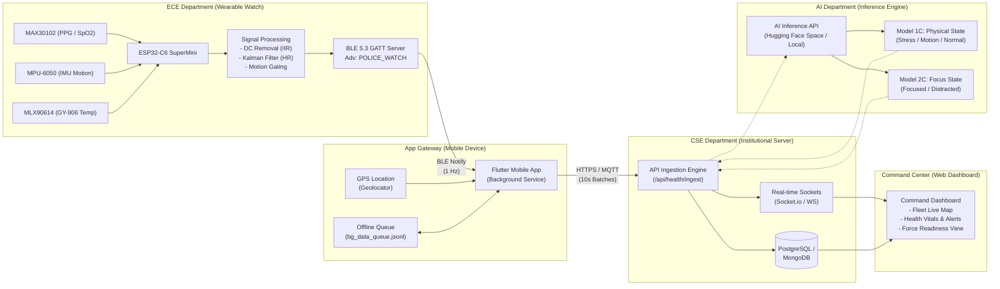

# Project SPANDAN — Master Replication & System Architecture Guide

> **Collaboration**: Sardar Vallabhbhai National Institute of Technology (SVNIT) Surat & Gujarat Police  
> **Target**: Wearable Health Monitoring, Early Stress Detection & Force Readiness System  
> **Last Updated**: November 2026

---

## 1. System Ecosystem & Repositories

Project SPANDAN integrates four core engineering sub-systems across three departments (ECE, CSE, and AI):

| Subsystem / Team | Repository / Folder | Active Branch | Primary Technology | Responsibility |
| :--- | :--- | :--- | :--- | :--- |
| **ECE (Hardware & Firmware)** | [`Guj_police_Wearable`](./Guj_police_Wearable) | `main` | ESP32-C6 (RISC-V), C++, Arduino, I2C, BLE 5.3 | Sensor integration (MAX30102, MPU-6050, MLX90614), IIR DC-removal, beat detection, Kalman filtering, BLE GATT server |
| **Mobile Gateway (App)** | [`bletomp`](./bletomp) (`ble_to_mp/mobile_app`) | `main` | Flutter (Dart), Android Foreground Service, `flutter_blue_plus` | Always-on BLE connection, GPS location tagging, offline disk queue (`bg_data_queue.jsonl`), backend relay |
| **CSE (Backend & Dashboard)** | [`guardian-health`](./guardian-health) | `main` | React + Vite + TypeScript, Bun + Hono, PostgreSQL / Drizzle, Caddy, Docker | Ingestion REST API (`/api/health/ingest`), authentication, command dashboard, fleet map, alerts |
| **CSE (Legacy Node/Express Ingest)** | [`bletomp`](./bletomp) (`ble_to_mp/server`) | `main` | Node.js / Express, Socket.io, SQLite / CSV | Rapid ingestion server, WebSocket pusher, direct database recovery |
| **AI Department** | [`Spandan`](./Spandan) | `main` | Python, PyTorch / Scikit-Learn, Gradio, FastAPI / HF Spaces | Model 1C (physical state: Stress / Physical / Normal), Model 2C (focus: Focused / Distracted), live analytics |
| **Hardware Display Demo** | [`waveshare_demo`](./waveshare_demo) | `main` | Arduino C++, Waveshare ESP32 Display Drivers | Touch display testing, UI evaluation, RTC testing |

---

## 2. End-to-End System Architecture



---

## 3. Communication & Data Specifications

### 3.1 BLE GATT Specifications (Watch to App)
- **Advertised Name**: `POLICE_WATCH` (or `SVNIT_CRL_16` / `POLICE_WATCH_DHRUV`)
- **Service UUID**: `4fafc201-1fb5-459e-8fcc-c5c9c331914b`
- **Notify Characteristic UUID**: `beb5483e-36e1-4688-b7f5-ea07361b26a8`
- **Raw ASCII Payload Format**:
  ```text
  FIFO_IR=<val>,FIFO_RED=<val>,S1_IR=<hex>,S1_RED=<hex>,IR_DC=<val>,IR_AC=<val>,RED_DC=<val>,RED_AC=<val>,HR=<bpm>,SpO2=<pct>%,ObjT=<degC>,AmbT=<degC>,accX=<val>,accY=<val>,accZ=<val>,accMag=<val>,accMagF=<val>,gMagF=<val>,gX=<val>,gY=<val>,gZ=<val>,ST=<status>,Q=<quality>
  ```

### 3.2 Mobile to Backend Ingestion JSON Schema
The mobile app batches incoming readings every 10 seconds, adds GPS coordinates, and posts to `/api/health/ingest`:
```json
{
  "officer_id": "PX-214",
  "device_id": "XX:XX:XX:XX:XX:XX",
  "session_id": "sess_1731662900",
  "timestamp": "2026-11-15T12:08:26Z",
  "location": {
    "latitude": 21.1702,
    "longitude": 72.8311,
    "altitude": 14.5
  },
  "readings": [
    {
      "heart_rate": 78.4,
      "spo2": 98.2,
      "temperature": 34.6,
      "ambient_temperature": 29.1,
      "motion": {
        "acc_x": 0.012,
        "acc_y": -0.045,
        "acc_z": 0.982,
        "acc_mag": 0.983,
        "gyro_mag": 1.2
      },
      "status": "OK",
      "quality": 95,
      "battery": 87
    }
  ]
}
```

---

## 4. Replication Playbook (Step-by-Step)

### Phase 1: Hardware & Firmware (ECE)
1. **Hardware Connections (I2C Bus)**:
   - ESP32-C6 SuperMini GPIO: `SDA = GPIO15`, `SCL = GPIO14`
   - Interrupt Pins: `MPU_INT = GPIO18`, `MAX_INT = GPIO7`
   - Sensors: MAX30102 (`0x57`), MPU-6050 (`0x68`), GY-906 MLX90614 (`0x5A`) on shared 3.3V I2C bus.
2. **Flashing Firmware**:
   - Open Arduino IDE (with ESP32 board package installed).
   - Select Board: `ESP32C6 Dev Module` / `ESP32-C6 SuperMini`.
   - Open sketch: `Guj_police_Wearable/FINAL_POC_WRIST13.ino` (or `Spandan/FINAL_POC_WRIST13.ino`).
   - Compile and flash via USB-C.
   - Verify Serial Monitor at `115200 baud` shows `SVNIT_CRL_16 READY` and data streaming.

### Phase 2: Mobile Gateway App (Flutter)
1. **Prerequisites**: Flutter SDK (3.24+), Android SDK (API 34+), physical Android device with Bluetooth & Location enabled.
2. **Build & Run**:
   ```bash
   cd bletomp/ble_to_mp/mobile_app
   flutter clean
   flutter pub get
   flutter run
   ```
3. **Building Release APK**:
   ```bash
   flutter build apk --release
   ```
4. **App Setup**:
   - Grant Bluetooth and Background Location permissions.
   - Start scan, connect to `POLICE_WATCH` / `SVNIT_CRL_16`.
   - Configure Server URL in Settings (`http://<server-ip>:3000` or production URL).

### Phase 3: Web Dashboard & Backend (CSE)
1. **Option A: Running with Docker (Recommended)**
   ```bash
   cd guardian-health
   docker compose -f docker-compose.dev.yml up --build
   ```
   - Open browser: `http://localhost`
   - Access API health check: `http://localhost/api/health`

2. **Option B: Running with Bun (Local Dev)**
   ```bash
   # Terminal 1: Backend
   cd guardian-health/server
   bun install
   bun run dev

   # Terminal 2: Frontend
   cd guardian-health
   bun install
   bun run dev
   ```

### Phase 4: AI Inference & Analytics (AI Department)
1. **Model Pipeline**:
   - Model 1C (`best_models/Model_1C_Physical_State.pkl` or inside `Spandan/models/`): Physical state inference.
   - Model 2C (`best_models/Model_2C_Focus_Monitoring.pkl`): Officer focus / distraction inference.
2. **Running the Gradio / Analytics Dashboard**:
   ```bash
   cd Spandan
   pip install -r requirements.txt  # (or install torch, gradio, scikit-learn, pandas, numpy)
   python dashboard/app.py
   ```
3. **Hugging Face Live Endpoint**:
   - Public Space: `https://huggingface.co/spaces/TheDeepDas/Spandan`
   - Model Training & Inference Code: `https://github.com/THE-DEEPDAS/Spandan`

---

## 5. Quick Replication Checklist

- [ ] ESP32-C6 watch flasher returns 1Hz BLE GATT notifications
- [ ] Flutter app connects, parses `FIFO_IR`, `HR`, `SpO2`, `accX/Y/Z`, and shows live telemetry
- [ ] Background service persists packets into `bg_data_queue.jsonl` when offline
- [ ] Backend receives batches on `/api/health/ingest` and writes to database
- [ ] Command dashboard reflects real-time status, GPS location, and alert thresholds
- [ ] AI models classify physical state (Stress/Normal/Activity) and focus state
